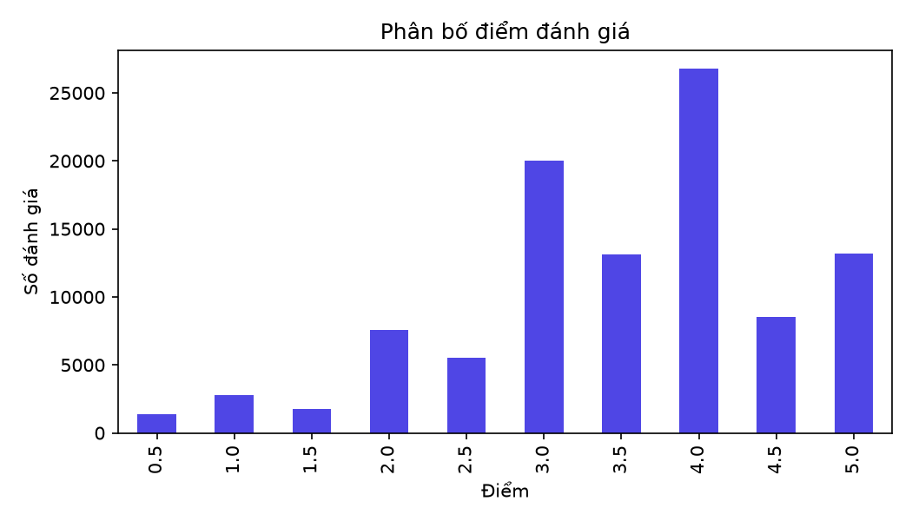
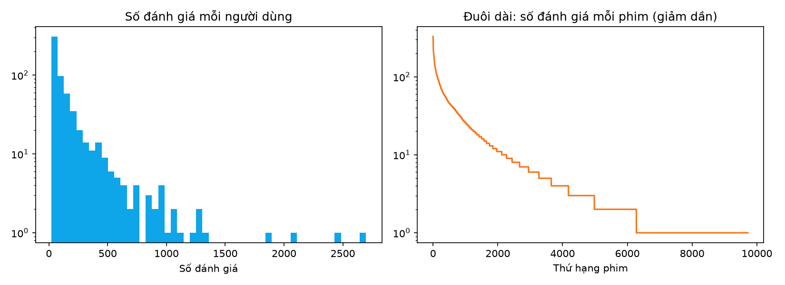
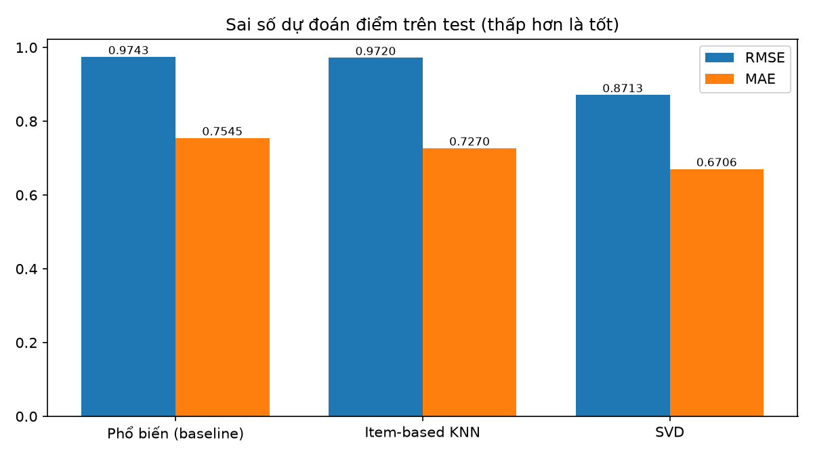
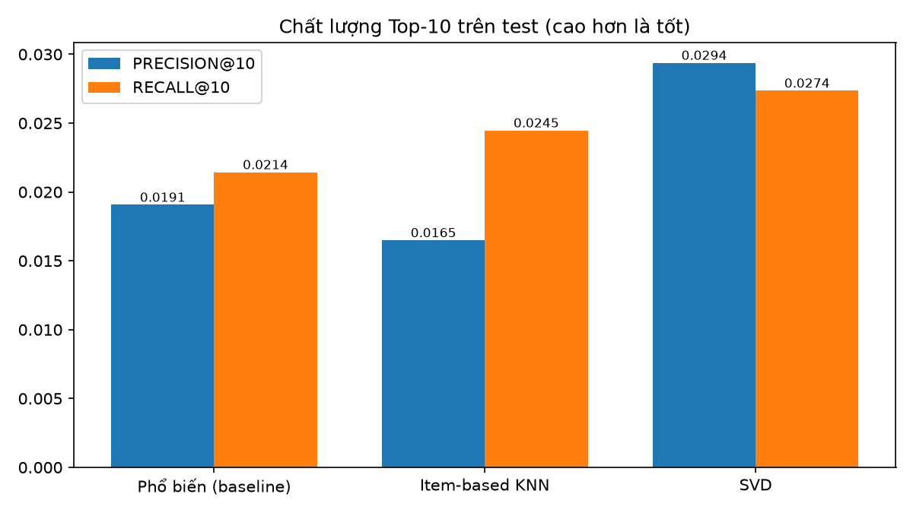

# 🎬 MovieRec — AI-Powered Personalized Movie Recommendation System
### Xây dựng Website Gợi ý Phim Cá nhân hóa Ứng dụng Trí tuệ Nhân tạo (Lọc Cộng tác)


-61DAFB?logo=react&logoColor=black)


> **Đồ án Cơ sở 2 — Ngành Công nghệ Thông tin**  
> **Sinh viên thực hiện:** Phan Quốc Duy · **MSSV:** `235019` · **Lớp:** `DH23TIN05`  
> **GitHub:** [@Phanquocduy-23](https://github.com/Phanquocduy-23)

---

## 🌟 Điểm nổi bật của Dự án (Key Highlights)

1. **Hệ thống Gợi ý Đa nhánh (Multi-Branch Collaborative Filtering Engine):**
   - **Popularity Baseline (Weighted Rating kiểu IMDb):** $WR_i = \frac{v_i}{v_i+m}R_i + \frac{m}{v_i+m}C$ làm mốc đối sánh khách quan và xử lý người dùng chưa có lịch sử (Cold-start).
   - **Item-based Collaborative Filtering (KNN Adjusted Cosine):** Chuẩn hóa điểm lệch trung bình từng người dùng $\tilde{r}_{ui} = r_{ui} - \mu_u$, cho phép **cá nhân hóa tức thời** ngay khi người dùng mới chấm vài bộ phim mà không cần huấn luyện lại toàn bộ mô hình, đồng thời **giải thích lý do gợi ý** (*"Vì bạn thích: ..."*).
   - **Matrix Factorization (SVD):** Học các vector nhân tố ẩn $\hat{r}_{ui} = \mu + b_u + b_i + p_u^T q_i$ để nắm bắt sở thích tiềm ẩn sâu của người dùng.
2. **Kiến trúc Phục vụ Trực tuyến & Chống Rò rỉ Dữ liệu (Production-Grade Serving):**
   - Tách biệt hoàn toàn định danh người dùng nghiên cứu MovieLens (`ml:<id>`) và tài khoản thực trên web (`web:<id>`).
   - Quản lý vòng đời mô hình (**Model Registry**): Huấn luyện nền bất đồng bộ, kiểm tra đầu ra tự động (`validate_bundle`) trước khi kích hoạt, hỗ trợ **Rollback** về phiên bản trước nếu mô hình mới gặp sự cố, kèm bộ nhớ đệm LRU gắn với `(user_id, model_version, ratings_updated_at)`.
3. **Giao diện Web Điện ảnh Hiện đại (Full-Stack ReactJS + FastAPI):**
   - Tìm kiếm tức thời (Live Autocomplete Search), Banner Spotlight Carousel 5 phim, phát **Trailer YouTube nhúng**, hiển thị thông tin đạo diễn/diễn viên/giải thưởng/điểm IMDb cho **9.742 bộ phim**, thống kê **Hồ sơ Gu Phim cá nhân**, và cổng Quản trị 7 màn hình (kèm xuất báo cáo CSV và Form Chính–Chi tiết).

---

## 📊 Kết quả Thực nghiệm trên MovieLens (`ml-latest-small`)

- **Quy mô dữ liệu:** `100.836` đánh giá · `610` người dùng · `9.742` bộ phim (Độ thưa ma trận: `98.30%`).
- **Giao thức chia tập:** Chia theo thứ tự thời gian của từng người dùng (**70% Train** = `70.580` / **15% Validation** = `15.145` / **15% Test** = `15.111`, kiểm tra chồng lấn = `0`).

| Phương pháp | Tham số | RMSE ↓ | MAE ↓ | Precision@10 ↑ | Recall@10 ↑ |
|---|---|---:|---:|---:|---:|
| **Popularity (Baseline)** | `m = 5` | 0.9743 | 0.7545 | 0.0191 | 0.0214 |
| **Item-based KNN** | `k = 20, shrink = 0.0` | 0.9720 | 0.7270 | 0.0165 | 0.0245 |
| **SVD (Matrix Factorization)** | `factors = 20, epochs = 20` | **0.8713** | **0.6706** | **0.0294** | **0.0274** |

### Trực quan hóa Dữ liệu (EDA) & Kết quả Thực nghiệm
| Phân bố điểm đánh giá | Phân phối đuôi dài (Long-tail) |
|---|---|
|  |  |

| So sánh RMSE & MAE trên tập Test | So sánh Precision@10 & Recall@10 trên tập Test |
|---|---|
|  |  |

---

## 🏗️ Cấu trúc Thư mục Dự án

```text
movie-recommender/
├── backend/                  # FastAPI REST API + SQLAlchemy 2.0 + Alembic Migration
│   ├── alembic/              # Quản lý phiên bản schema CSDL (14 bảng)
│   ├── app/
│   │   ├── routers/          # REST API: auth, movies, ratings, recommendations, admin
│   │   ├── services/         # Nghiệp vụ: recommender (3 nhánh), training, importer (SHA-256)
│   │   ├── scripts/seed.py   # Khởi tạo dữ liệu mẫu, tài khoản demo & huấn luyện mô hình
│   │   ├── models.py         # 14 bảng CSDL chia theo 6 nhóm nghiệp vụ
│   │   ├── schemas.py        # Pydantic v2 validation schemas
│   │   └── security.py       # JWT & Bcrypt
│   └── tests/                # Bộ kiểm thử tự động pytest (15/15 passed)
├── frontend/                 # Giao diện người dùng & trang quản trị ReactJS (Vite)
│   └── src/
│       ├── components/       # MovieCard, StarInput (0.5–5.0), TrailerModal, BarChart, Guards
│       └── pages/            # Home, Movies, MovieDetail, Recommendations, MyRatings, Watchlist, Admin/*
├── recsys/                   # Thư viện lõi AI dùng chung cho thực nghiệm offline và phục vụ web
│   ├── algorithms.py         # PopularityRecommender, ItemKNNRecommender, SVDRecommender
│   ├── data.py               # Làm sạch dữ liệu, SHA-256, chia tập theo thời gian từng người
│   └── metrics.py            # RMSE, MAE, Precision@10, Recall@10, Catalog Coverage
├── ml/                       # Pipeline thực nghiệm AI độc lập (tái lập được)
│   ├── config.json           # Lưới siêu tham số (Grid Search) và tiêu chí chọn mô hình
│   ├── download_data.py      # Tải MovieLens ml-latest-small & tạo manifest SHA-256
│   ├── prepare_data.py       # Làm sạch, thống kê EDA, vẽ biểu đồ, xuất train/val/test
│   └── train_evaluate.py     # Huấn luyện, chọn tham số trên Val, đo Test 1 lần, vẽ biểu đồ
├── docs/                     # Hồ sơ thiết kế UML, CSDL (CDM/LDM/PDM), kịch bản Demo & Hỏi đáp
└── scripts/                  # Script thiết lập tự động, cập nhật poster & backup/restore PostgreSQL
```

---

## 🚀 Hướng dẫn Cài đặt & Khởi chạy Nhanh (Quick Start)

### Cách 1: Chạy tự động trên Windows
```powershell
# 1. Cài đặt thư viện Python & tự động tải dữ liệu MovieLens, chạy thực nghiệm, khởi tạo CSDL
pip install -r backend/requirements.txt
python scripts/setup_and_seed.py
python scripts/update_posters.py

# 2. Cài đặt gói giao diện ReactJS
cd frontend
npm install
cd ..

# 3. Nhấp đúp vào file run_web.bat (hoặc chạy từ terminal) để bật Backend + Frontend
.\run_web.bat
```

### Cách 2: Chạy từng thành phần qua Terminal
- **Terminal 1 (Backend FastAPI — Cổng 8000):**
  ```powershell
  cd backend
  uvicorn app.main:app --reload --port 8000
  ```
- **Terminal 2 (Frontend ReactJS — Cổng 5173):**
  ```powershell
  cd frontend
  npm run dev -- --port 5173
  ```
- Truy cập giao diện Web tại **http://localhost:5173** và tài liệu API Swagger tại **http://localhost:8000/docs**.

---

## 🔑 Tài khoản Demo Dựng sẵn

| Vai trò | Tên đăng nhập / Email | Mật khẩu | Kịch bản Minh họa |
|---|---|---|---|
| **Quản trị viên** | `admin` / `admin@movierec.local` | `Admin@123` | Thống kê hệ thống, xuất báo cáo CSV, quản lý phim/người dùng (Form Chính–Chi tiết), chạy job huấn luyện & Rollback mô hình |
| **Người dùng Gu A** | `demo_action` | `Demo@123` | Đã chấm điểm cao phim *Action / Sci-Fi* $\rightarrow$ Nhận gợi ý từ mô hình **SVD** |
| **Người dùng Gu B** | `demo_romance` | `Demo@123` | Đã chấm điểm cao phim *Romance / Drama* $\rightarrow$ Danh sách Top-10 khác biệt hoàn toàn với Gu A |
| **Người dùng mới** | `demo_new` | `Demo@123` | Chưa có đánh giá $\rightarrow$ Minh họa **Cold-start Fallback** sang Phổ biến, và tự động chuyển sang **Item-based KNN** ngay khi chấm điểm |

---

## 🧪 Kiểm thử Tự động & Hồ sơ Thiết kế

```powershell
cd backend
pytest -v
```
- **Tài liệu Phân tích Thiết kế Hệ thống & CSDL (UML, ERD, 1NF–3NF):** [docs/SYSTEM_DESIGN_UML_AND_DB.md](docs/SYSTEM_DESIGN_UML_AND_DB.md)
- **Kịch bản Demo Bảo vệ & Bộ Câu hỏi Phản biện:** [docs/DEMO_AND_DEFENSE_QA.md](docs/DEMO_AND_DEFENSE_QA.md)
- **Nhật ký Tiến độ Đồ án:** [PROGRESS.md](PROGRESS.md)
