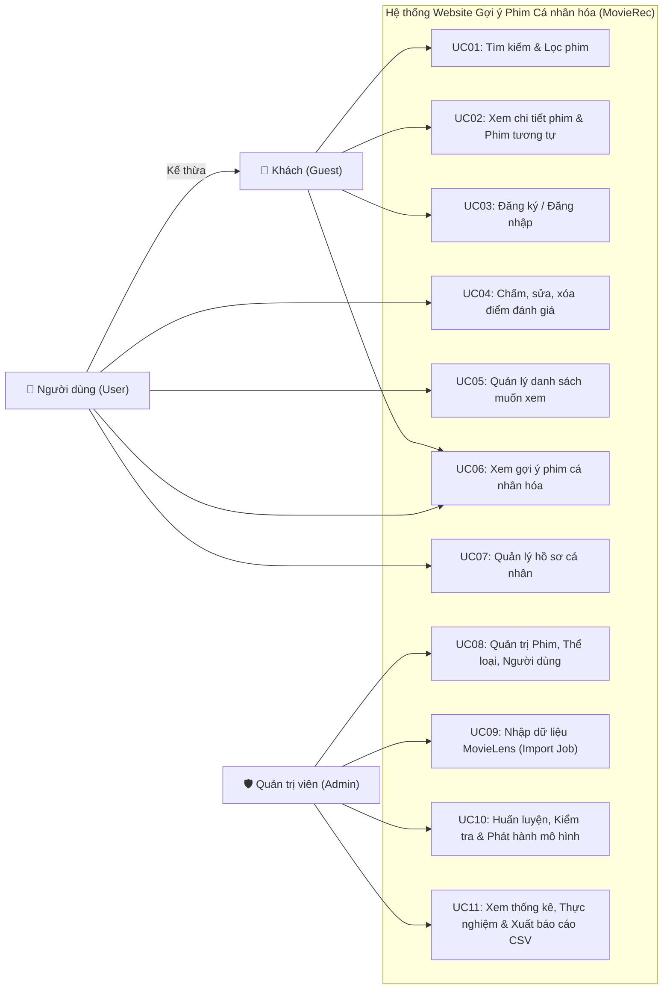
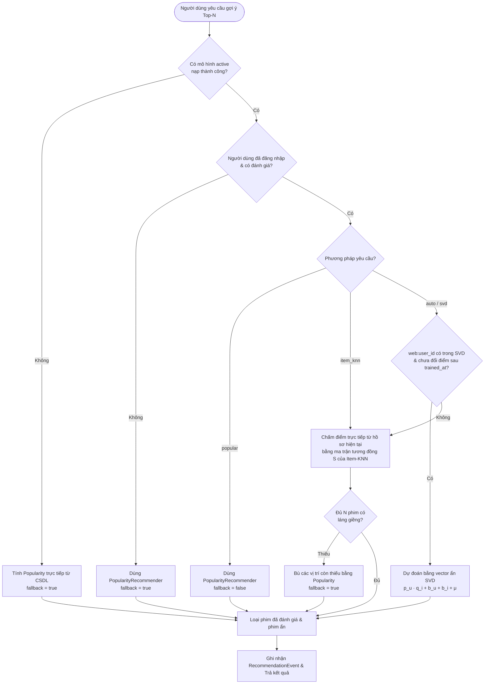
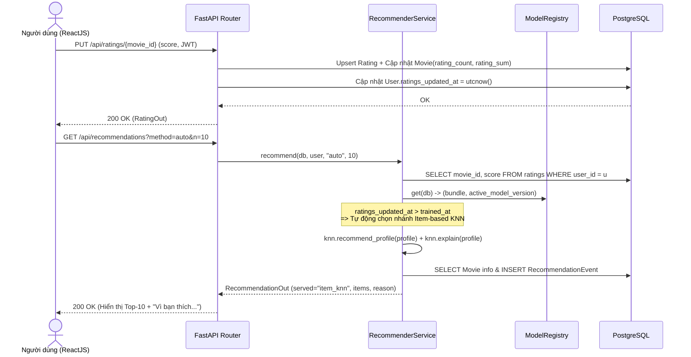
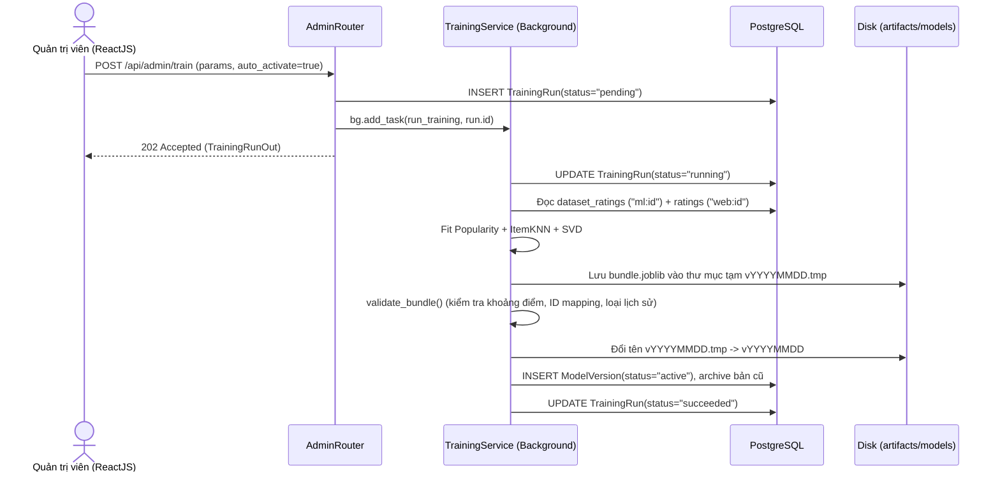
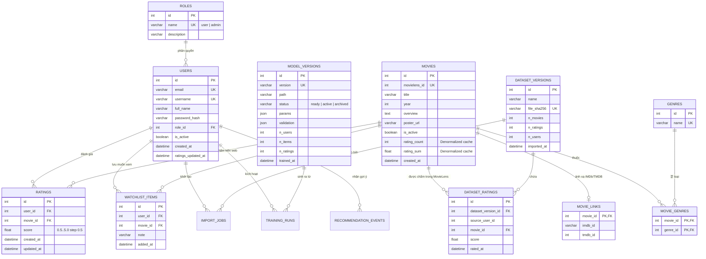

# Hồ sơ Phân tích Thiết kế Hệ thống & Cơ sở dữ liệu (Chương 4)

**Đề tài:** Xây dựng website gợi ý phim cá nhân hóa ứng dụng trí tuệ nhân tạo sử dụng lọc cộng tác dựa trên đánh giá người dùng  
**Sinh viên:** Phan Quốc Duy — **MSSV:** `235019` — **Lớp:** `DH23TIN05`

---

## 1. Đối chiếu Tiêu chí Chấm điểm (Sheet Phần mềm & Sheet AI)

Để chủ động trước cả 2 phương án chấm của giảng viên (hoặc kết hợp cả hai), hệ thống đã được thiết kế đáp ứng trọn vẹn cả hai bộ tiêu chí:

### 1.1. Đối chiếu Sheet Phần mềm (Tối thiểu 10 chức năng đối tượng + 2 chức năng quy trình)
| STT | Phân loại | Tên chức năng / Màn hình | Đường dẫn UI / Endpoint API | Ghi chú kỹ thuật |
|---|---|---|---|---|
| 1 | Đối tượng (1) | Đăng ký & Đăng nhập tài khoản | `/login`, `/register` · `POST /api/auth/*` | Bcrypt + JWT |
| 2 | Đối tượng (2) | Quản lý hồ sơ & Đổi mật khẩu | `/profile` · `GET,PUT /api/auth/me` | Xác minh mật khẩu cũ |
| 3 | Đối tượng (3) | Khám phá, Tìm kiếm & Đa bộ lọc phim | `/movies` · `GET /api/movies` | Lọc tên, thể loại, năm, sắp xếp, phân trang |
| 4 | Đối tượng (4) | Chi tiết phim & Biểu đồ phân bố điểm | `/movies/:id` · `GET /api/movies/{id}` | Điểm cộng đồng, điểm cá nhân, phim tương tự |
| 5 | Đối tượng (5) | Chấm điểm, Sửa & Xóa đánh giá cá nhân | `/my-ratings` · `GET,PUT,DELETE /api/ratings/*` | Thang 0.5–5.0 bước 0.5 |
| 6 | Đối tượng (6) | Quản lý Danh sách muốn xem & Ghi chú | `/watchlist` · `GET,POST,DELETE /api/watchlist/*` | Lưu ghi chú riêng cho từng phim |
| 7 | Đối tượng (7) | Quản trị Danh mục Phim (CRUD + Ẩn an toàn) | `/admin/movies` · `GET,POST,PUT,DELETE /api/admin/movies` | Xóa mềm khi phim đã có đánh giá |
| 8 | Đối tượng (8) | Quản trị Thể loại phim (CRUD) | `/admin/genres` · `POST,PUT,DELETE /api/admin/genres` | Kiểm tra trùng tên không phân biệt hoa thường |
| 9 | Đối tượng (9) | Quản trị Người dùng (**Form Chính – Chi tiết**) | `/admin/users` · `GET,PUT /api/admin/users/*` | Bảng người dùng (Chính) + Lịch sử điểm & Watchlist (Chi tiết) |
| 10 | Đối tượng (10) | Quản lý Phiên bản Mô hình & Rollback | `/admin/models` · `GET,POST /api/admin/models/*` | Theo dõi `ready` / `active` / `archived` |
| 11 | Đối tượng (11) | Quản lý Kết quả Thực nghiệm & Biểu đồ | `/admin/experiments` · `GET /api/admin/experiments` | Đối chiếu `RMSE`, `MAE`, `Precision@10`, `Recall@10` |
| 12 | **Quy trình (1)** | **Quy trình Gợi ý Cá nhân hóa Đa nhánh & Fallback** | `/recommendations` · `GET /api/recommendations` | Tự động điều phối Cold-start → Item-KNN → SVD + giải thích lý do |
| 13 | **Quy trình (2)** | **Quy trình Nhập dữ liệu MovieLens & Huấn luyện nền** | `/admin/data`, `/admin/models` · `POST /api/admin/import`, `/train` | Kiểm tra SHA-256 → Làm sạch → Huấn luyện nền → Validate → Phát hành |
| 14 | **Thống kê & Report** | **Bảng điều khiển Thống kê & Xuất Báo cáo CSV** | `/admin` · `GET /api/admin/stats`, `/report/movies.csv` | Biểu đồ phân bố điểm, thể loại, lượt gọi AI + Xuất CSV có BOM UTF-8 |

---

## 2. Xác định Tác nhân & Biểu đồ Use Case

### 2.1. Các tác nhân (Actors)
1. **Khách (Guest):** Người dùng chưa đăng nhập; được phép duyệt danh mục phim, tìm kiếm/lọc, xem chi tiết phim, xem phim tương tự và xem gợi ý theo độ phổ biến.
2. **Người dùng đã đăng nhập (User):** Kế thừa quyền của Khách; được chấm/sửa/xóa điểm (0.5–5.0), quản lý danh sách muốn xem, nhận gợi ý cá nhân hóa (SVD / Item-based KNN) kèm giải thích, và quản lý hồ sơ cá nhân.
3. **Quản trị viên (Admin):** Quản lý danh mục phim, thể loại, người dùng (phân quyền, khóa/mở khóa), nhập dữ liệu MovieLens, kích hoạt huấn luyện mô hình nền, phát hành/rollback phiên bản mô hình, xem thống kê và xuất báo cáo CSV.
*(Lưu ý: Mô hình AI là thành phần xử lý nội bộ của hệ thống, không vẽ thành tác nhân bên ngoài).*

### 2.2. Biểu đồ Use Case tổng quát

---

## 3. Đặc tả 4 Use Case Cốt lõi

### 3.1. UC04 — Đánh giá phim (Chấm / Sửa / Xóa điểm)
- **Tác nhân:** Người dùng đã đăng nhập (`User`).
- **Tiền điều kiện:** Người dùng đã xác thực bằng JWT hợp lệ; bộ phim tồn tại và đang hiển thị (`is_active = true`).
- **Luồng sự kiện chính (Tạo mới / Cập nhật điểm):**
  1. Người dùng chọn mức điểm $s \in \{0.5, 1.0, 1.5, \dots, 5.0\}$ trên thanh sao tại trang Chi tiết phim hoặc Lịch sử đánh giá.
  2. Frontend gửi yêu cầu `PUT /api/ratings/{movie_id}` kèm `{ "score": s }` và header `Authorization: Bearer <token>`.
  3. Backend kiểm tra token, kiểm tra $0.5 \le s \le 5.0$ và $2s \in \mathbb{Z}$.
  4. Nếu cặp `(user_id, movie_id)` chưa tồn tại trong bảng `ratings`: thêm bản ghi mới, tăng `movies.rating_count += 1` và `movies.rating_sum += s`.
  5. Nếu đã tồn tại: cập nhật `movies.rating_sum += (s - old_score)`, ghi điểm mới và `updated_at`.
  6. Cập nhật `users.ratings_updated_at = utcnow()` để đánh dấu hồ sơ người dùng vừa thay đổi (giúp bộ điều phối gợi ý tự động chuyển sang nhánh Item-based KNN cập nhật tức thời).
  7. Trả về thông tin đánh giá mới (HTTP 200).
- **Luồng ngoại lệ:**
  - *E1 (Điểm ngoài thang):* Hệ thống từ chối với mã `422 Unprocessable Entity`.
  - *E2 (Phim không tồn tại hoặc bị ẩn):* Trả về `404 Not Found`.

### 3.2. UC06 — Lấy gợi ý phim cá nhân hóa
- **Tác nhân:** `User` hoặc `Guest`.
- **Tiền điều kiện:** Danh mục phim đã được nạp vào CSDL.
- **Luồng sự kiện chính:**
  1. Người dùng mở trang Trang chủ hoặc Gợi ý cho bạn (`/recommendations`), chọn phương pháp (`auto`, `svd`, `item_knn`, `popular`).
  2. Backend đọc hồ sơ đánh giá hiện tại của người dùng từ bảng `ratings` và nạp gói mô hình đang có `status = 'active'` từ `ModelRegistry`.
  3. Bộ điều phối quyết định nhánh phục vụ:
     - **Nhánh 1 (Khách hoặc tài khoản mới chưa có đánh giá):** Trả về Top-$N$ theo độ phổ biến có trọng số (`served_method = 'popular'`, `fallback = true`).
     - **Nhánh 2 (Tài khoản đã có trong mô hình SVD và chưa sửa điểm sau `trained_at`):** Dự đoán $\hat{r}_{ui} = \mu + b_u + b_i + p_u^T q_i$ trên toàn bộ phim chưa xem, trả về Top-$N$ (`served_method = 'svd'`).
     - **Nhánh 3 (Tài khoản mới vừa chấm điểm hoặc vừa sửa điểm sau lần train SVD):** Dùng trực tiếp ma trận tương đồng phim $S$ của `ItemKNNRecommender` nhân với vector điểm lệch trung bình của hồ sơ hiện tại để chấm điểm ứng viên ngay lập tức mà không cần train lại (`served_method = 'item_knn'`), đồng thời trích xuất tối đa 2 phim đã thích có tương đồng cao nhất làm lời giải thích (*"Vì bạn thích: ..."*). Nếu số phim đủ láng giềng $< N$, bù phần thiếu bằng phim phổ biến.
  4. Loại bỏ toàn bộ phim người dùng đã đánh giá và phim có `is_active = false`.
  5. Lưu nhật ký vào `recommendation_events` và trả về danh sách kèm metadata (`served_method`, `model_version`, `fallback`, `reason`).

### 3.3. UC05 — Quản lý danh sách muốn xem (Watchlist)
- **Tác nhân:** `User`.
- **Tiền điều kiện:** Người dùng đã đăng nhập.
- **Luồng sự kiện chính:**
  1. Người dùng nhấn **"+ Muốn xem"** tại trang Chi tiết phim hoặc cập nhật ghi chú tại trang `/watchlist`.
  2. Backend lấy `user_id` từ JWT token (không nhận từ body để chống giả mạo chéo tài khoản), kiểm tra ràng buộc duy nhất `(user_id, movie_id)` và lưu vào `watchlist_items`.
  3. Khi người dùng nhấn **"Bỏ"**, hệ thống xóa bản ghi tương ứng của chính `user_id` đó.

### 3.4. UC10 — Huấn luyện, Kiểm tra & Phát hành mô hình
- **Tác nhân:** Quản trị viên (`Admin`).
- **Tiền điều kiện:** Đã đăng nhập tài khoản có vai trò `admin`; đã nhập dữ liệu MovieLens.
- **Luồng sự kiện chính:**
  1. Quản trị viên gửi cấu hình tham số (`svd_factors`, `svd_epochs`, `knn_k`, `pop_m`, `auto_activate`) qua `POST /api/admin/train`.
  2. Backend kiểm tra khóa `_train_lock` (nếu đang có job chạy thì trả `409 Conflict`, giữ nguyên mô hình đang hoạt động).
  3. Tạo bản ghi `training_runs` với `status = 'pending'`, kích hoạt tác vụ nền (`BackgroundTasks`).
  4. Tác vụ nền gộp đánh giá MovieLens (`ml:<source_user_id>`) và đánh giá web (`web:<user_id>`), huấn luyện cả 3 mô hình `PopularityRecommender`, `ItemKNNRecommender`, `SVDRecommender` và ghi vào thư mục tạm `<version>.tmp`.
  5. Chạy `validate_bundle()` kiểm tra: điểm dự đoán hữu hạn trong $[0.5, 5.0]$, mọi `movie_id` đều khớp CSDL, danh sách Top-10 không rỗng và không chứa phim đã xem.
  6. Đổi tên thư mục tạm thành bản chính thức, tạo bản ghi `model_versions`. Nếu `auto_activate = true`, chuyển bản mới sang `active`, bản cũ sang `archived` và xóa cache gợi ý.
- **Luồng ngoại lệ:**
  - *E1 (Lỗi trong khi train hoặc kiểm tra thất bại):* Xóa thư mục `.tmp`, ghi thông báo lỗi vào `training_runs.message` (`status = 'failed'`), giữ nguyên phiên bản mô hình đang hoạt động.

---

## 4. Biểu đồ Hoạt động (Activity) & Tuần tự (Sequence)

### 4.1. Activity Diagram — Luồng Đánh giá & Phục vụ Gợi ý 3 nhánh

### 4.2. Sequence Diagram — Chấm điểm và Lấy gợi ý cá nhân hóa

### 4.3. Sequence Diagram — Quản trị viên Huấn luyện & Phát hành mô hình

---

## 5. Thiết kế Cơ sở dữ liệu (CDM → LDM → PDM & Chuẩn hóa)

### 5.1. Sơ đồ Thực thể – Liên kết (ERD / PDM)

### 5.2. Chứng minh Chuẩn hóa CSDL (1NF → 2NF → 3NF)
1. **Dạng chuẩn 1 (1NF):**
   - Trong file gốc `movies.csv` của MovieLens, cột `genres` lưu chuỗi đa trị dạng `"Action|Adventure|Sci-Fi"`.
   - Khi đưa vào PostgreSQL, thuộc tính đa trị này được tách thành bảng `genres(id, name)` và bảng liên kết nhiều–nhiều `movie_genres(movie_id, genre_id)`. Mọi thuộc tính trong tất cả 14 bảng đều nguyên tố (atomic) $\Rightarrow$ **Đạt 1NF**.
2. **Dạng chuẩn 2 (2NF):**
   - Bảng có khóa chính ghép là `movie_genres(movie_id, genre_id)` không có thuộc tính phi khóa nào phụ thuộc bộ phận vào một phần khóa chính. Tên thể loại nằm ở `genres`, tiêu đề phim nằm ở `movies`.
   - Các bảng `ratings`, `watchlist_items`, `dataset_ratings` có khóa chính đơn `id` và ràng buộc duy nhất `UNIQUE(user_id, movie_id)` $\Rightarrow$ **Đạt 2NF**.
3. **Dạng chuẩn 3 (3NF):**
   - Thông tin vai trò (`role.name`, `role.description`) được tách sang bảng `roles`, bảng `users` chỉ lưu khóa ngoại `role_id`, loại bỏ phụ thuộc bắc cầu `user_id → role_id → role_name`.
   - Thông tin liên kết ngoài (`imdb_id`, `tmdb_id`) được tách sang bảng `movie_links(movie_id, imdb_id, tmdb_id)`.
   - **Ghi chú về phi chuẩn hóa có kiểm soát (Controlled Denormalization):** Hai cột `rating_count` và `rating_sum` trên bảng `movies` được lưu trữ nhằm phục vụ sắp xếp danh mục hơn 9.700 phim theo độ phổ biến và điểm trung bình trong $< 10\text{ ms}$ mà không phải `GROUP BY` hơn 100.000 dòng mỗi lần chuyển trang. Hai cột này được cập nhật đồng bộ trong cùng transaction khi người dùng chấm/sửa/xóa điểm và có hàm `recompute_movie_stats()` đối soát toàn cục.
   - **Tách nguồn người dùng:** `dataset_ratings.source_user_id` lưu định danh ẩn danh của bộ dữ liệu nghiên cứu MovieLens, tách biệt hoàn toàn với `users.id` (tài khoản web thật), đảm bảo tài khoản đăng ký mới không bao giờ nhận nhầm lịch sử của người dùng MovieLens có cùng số thứ tự.
